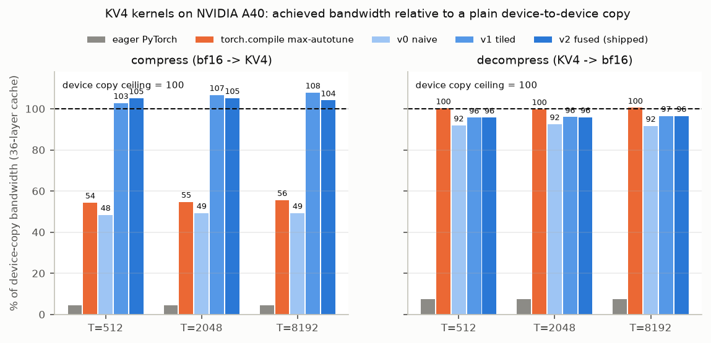
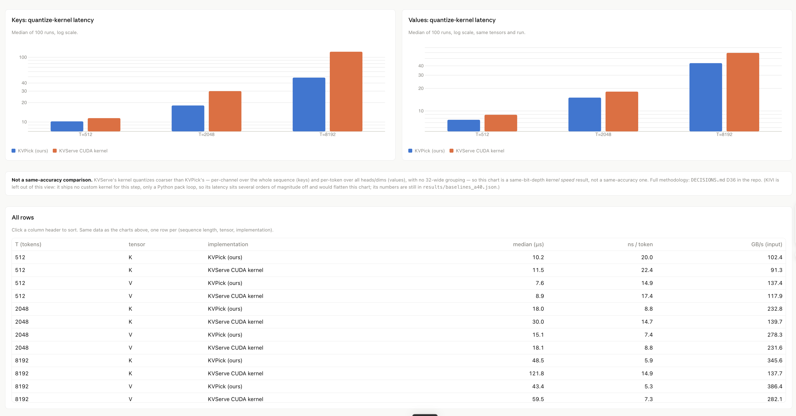
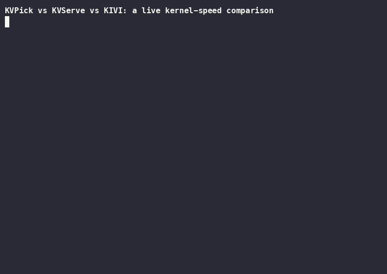
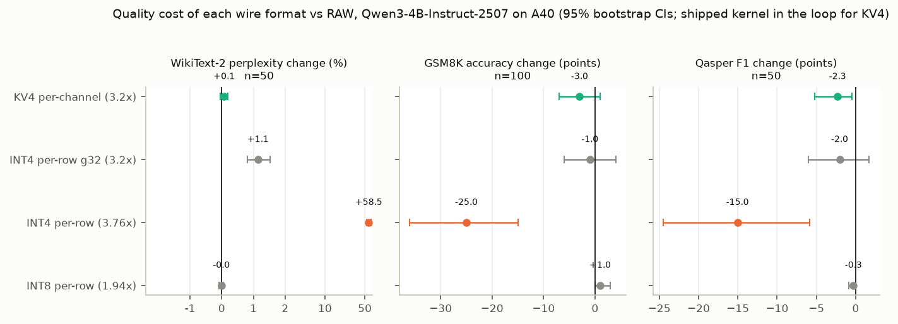
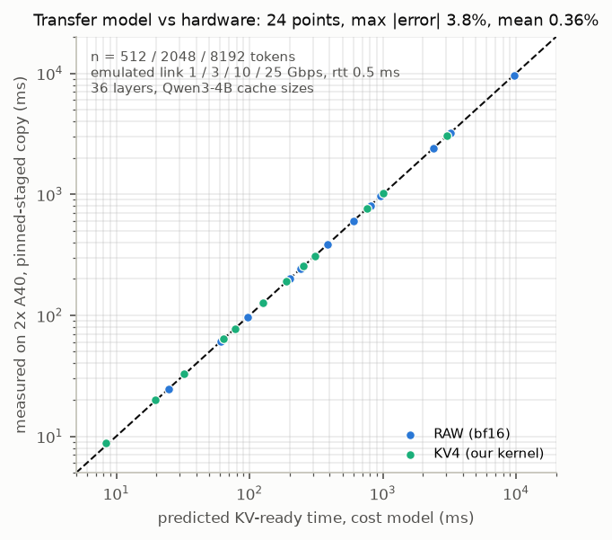
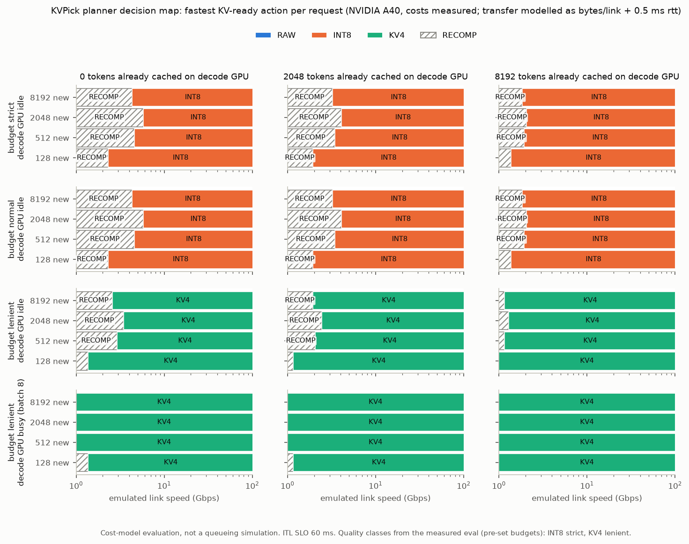
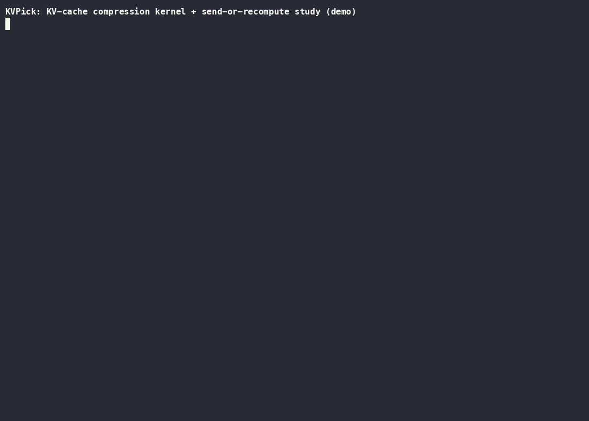

# KVPick: a KV-cache compression kernel and a measured send-or-recompute study for split prefill/decode LLM serving

When prefill and decode run on different GPUs, the prompt's KV cache has to cross a network. For Qwen3-4B that is
147 KB per token: 302 MB for a 2k-token prompt, 1.2 GB for 8k. This repository contains

1. **a fused CUDA kernel** that packs the cache into a 4-bit per-channel format ("KV4", 3.2x smaller) at the GPU's
   memory-bandwidth ceiling, as a PyTorch C++ extension, bit-exact against a C++ and a Python reference;
2. **a measurement study** on real A40s of when to send the cache raw, send it compressed, or not send it and recompute
   it on the decode GPU, with the transfer model validated on two GPUs; and
3. **a per-request planner** built from those measured costs, with its decision map.

Everything here was preceded by a pre-registered feasibility study (`feasibility/`) whose thresholds were fixed before
any data was collected; the project was reshaped by its results. Every number in this README is produced by a script
from a JSON in `results/` (`scripts/make_tables.py` writes `docs/tables.md`). The decision log `DECISIONS.md` records
every judgment call, including the ones that went against the original plan.

## Results in one screen

| Claim | Number | Source |
|---|---|---|
| KV4 compress kernel vs device-copy ceiling (A40, 36-layer cache) | 104-105% at T = 512 / 2048 / 8192 | `results/kernels_a40.json` |
| vs torch.compile max-autotune / vs eager PyTorch, T = 8192 | 1.9x / 24x faster (2.7 ms vs 5.1 ms vs 65 ms) | same |
| KV4 decompress | 96% of ceiling; torch.compile reaches 100% (compiler wins by 4%) | same |
| Correctness | bit-identical to Python and C++ references; 4 compute-sanitizer tools clean; 90 CPU + 58 GPU tests | `tests/`, `logs/` |
| Per-row INT4 vs per-channel INT4 at the same 3.2x | GSM8K -25 pts vs -3 pts; perplexity +58% vs +0.08% | `results/quality_a40.json` |
| INT8 per-row (1.94x) | lossless on all three tasks | same |
| Transfer model vs two-GPU hardware, 24 points | max error 3.8%, mean 0.36% | `results/transfer_validate_a40.json` |
| Link speed below which recomputing beats sending KV4 (measured end to end) | 3.5 Gbps (predicted 2.9-3.5) | same |
| Planner vs best fixed policy on a synthetic multi-round workload | +6.7% at 1 Gbps, +0.7% at 3 Gbps, 0% from 5 Gbps | `results/policy_compare.json` |
| KV4 compress kernel vs KVServe's own CUDA quantize kernel (same A40, same tensors, same run) | 1.1-2.5x faster (K), 1.2-1.4x faster (V), widening with T | `results/baselines_a40.json` |
| Paid GPU time, whole project | about 2.5 hours (1x A40, 1x RTX A5000, 2x A40), under $4 | `DECISIONS.md` D19, D25, D28 |

## 1. The kernel



**Format (KV4).** Keys are quantised per channel over groups of 32 tokens, values per token over groups of 32 dims,
both asymmetric 4-bit with fp16 scale and zero point, two codes per byte. 1280 B per token per layer against 4096 B
raw (3.2x). The layout and the exact arithmetic are pinned in `csrc/kvq.h`; `kvpick/ref/quant_wire.py` is the Python
reference and `csrc/kvq_ref.cpp` the C++ CPU reference. Why per channel: Qwen3-4B keys have a few fixed channels whose
magnitude is up to 38x the median (`results/feasibility/G1_key_channel_amax.png`); a per-row scale lets those channels
crush the other 127.

**Versions.** `csrc/kvq_kernels.cu` keeps three measured versions. v0: one thread per output byte, scales from a
separate kernel. v1: for keys, a 256-thread block per (32-token group, 4 heads) with the 32 tokens held in registers;
for values, a warp per row with 8-lane shuffle reductions. v2: the v1 bodies fused into **one launch for the whole
layer batch**, writing straight into one contiguous transfer buffer (`kvpick/ext.py: alloc_kv4_buffer`).

**What it took to reach the ceiling** (details in `DECISIONS.md` D24, D25):
- The first v1 ran at 54% (keys) and 66% (values) of the copy ceiling while the identical-byte decompress kernels ran
  at 100%. The compress kernels were instruction-bound: one IEEE fp32 division per element. Redefining the step as a
  multiply by a per-group reciprocal, in the reference and the kernel together so bit-exactness held, took both to 101%.
- The first fused v2 ran at 70%: it inherited the key path's 94 registers and starved the value blocks of occupancy.
  A value path with two rows per warp and 16-byte loads, plus `__launch_bounds__(256, 3)` (80 registers, no spills),
  made the fused kernel the fastest version at every size, including 96% at T = 128 where launch overhead matters most.
- One fp16-ulp disagreement in 1 of 50,000 groups between kernel and reference on real KV (never on random data) came
  from PyTorch dividing a tensor by a Python scalar as a reciprocal multiply. The reference now states the multiply
  explicitly (D29).

Decompression is a different story: torch.compile already reaches the copy ceiling there, and our kernel sits 4% below
it. We report that as is; the compress kernel is the one worth having written.

**Against other people's kernels.** `scripts/bench_baselines.py` times our v2 kernel against KVServe's actual CUDA
quantize kernels (vendored verbatim into `csrc/baselines/kvserve_kernels.cu`, Apache-2.0, attributed; not reimplemented)
and KIVI's pack step (`feasibility/external/kivi`, MIT), same A40, same tensors, same run, 4-bit codes on both sides
(`results/baselines_a40.json`, `DECISIONS.md` D36):

| | T=512 K / V (us) | T=2048 K / V | T=8192 K / V |
|---|---|---|---|
| **KVPick v2 (ours)** | 10.2 / 7.6 | 18.0 / 15.1 | 48.5 / 43.4 |
| KVServe CUDA kernel | 11.5 / 8.9 | 30.0 / 18.1 | 121.8 / 59.5 |
| KIVI pack (PyTorch) | 24,279 / 5,864 | 98,844 / 5,985 | 392,947 / 5,902 |

Ours is faster at every size: 1.1-2.5x vs KVServe on K (the gap widens with T because KVServe's channel kernel keeps a
fixed number of token-lanes per block regardless of sequence length, while ours adds one block per 32-token group),
1.2-1.4x on V. The KIVI gap (500-8000x) is not a kernel contest: KIVI ships no quantize *kernel* for this step, only a
fused dequant+GEMV for decode attention; its pack function is a Python advanced-indexing loop. Caveat that matters more
than the speed numbers: KVServe's kernel quantizes *coarser* than ours (per-channel over the whole sequence, per-token
over all heads/dims, no 32-wide grouping), so this is a same-bit-depth kernel-speed comparison, not a same-accuracy one.





A 17-second terminal recording (`docs/demo_baselines.cast`, `scripts/demo_baselines_session.sh`), recorded live on the
rented A40 that produced the numbers above.

## 2. Quality: the format decides everything



Protocol: prefill the prompt, quantise then dequantise the whole KV cache (the shipped kernel for KV4; the kernel path
is asserted equal to the reference once per run), inject it back as the cache, then score the continuation. WikiText-2
perplexity on 50 windows (1536-token prefix compressed, 512 scored), GSM8K accuracy on 100 questions (4-shot, greedy),
LongBench Qasper F1 on 50 documents. 95% paired bootstrap intervals.

| format | ratio | ppl change | GSM8K change (pts) | Qasper F1 change (pts) | budget class |
|---|---|---|---|---|---|
| INT8 per-row | 1.94x | -0.01 [-0.08, +0.06] % | +1.0 [0, +3] | -0.3 [-0.9, 0] | strict |
| INT4 per-row (the "obvious" layout) | 3.76x | +58.5 [+53, +64] % | -25 [-36, -15] | -15.1 [-24.5, -5.8] | none |
| INT4 per-row, groups of 32 | 3.2x | +1.14 [+0.81, +1.53] % | -1.0 [-6, +4] | -2.0 [-6.0, +1.7] | normal |
| **KV4 per-channel (ours)** | 3.2x | +0.08 [-0.04, +0.20] % | -3.0 [-7, +1] | -2.3 [-5.2, -0.5] | lenient |

Budget classes (`configs/quality_budgets.yaml`) were written before classification: strict <= 0.5 pt on every task,
normal <= 2.5, lenient <= 5, by point estimate. KV4 lands in *lenient* on the final run (-3.0 GSM8K points; the
feasibility run had -2.0 and would have been *normal*). With 100 questions one question is one point, so the class is
sensitive; we show the intervals rather than pick the better run (D33). INT8 is lossless. The naive per-row INT4 layout
that many quick implementations would choose is unusable.

## 3. Send or recompute: measured, then validated on two GPUs



Costs come from the A40: prefill time as a function of new tokens and cached tokens (14 points, fitted to 13.7% worst
case), decode step time vs batch, the kernel times above, and byte counts. Network speed is **emulated**: a token-bucket
delay layered over a real copy, exact to under 1% at every link speed up to 25 Gbps (`kvpick/link/link_emulator.py`).

On a two-A40 node we then ran the real thing: compress on GPU 0 with the fused kernel into one buffer, copy to GPU 1
paced by the emulator, decompress on GPU 1, for 512 / 2048 / 8192 tokens, raw and KV4, at 1 / 3 / 10 / 25 Gbps. The
model predicts the measured KV-ready time to within 3.8% worst case and 0.36% mean over 24 points. Running the real
prefill on GPU 1 as the recompute path, KV4 send becomes faster than recompute at **3.5 Gbps** for both 512 and 2048
new tokens (the model predicted 2.9 and 3.5). Two caveats: the node's direct peer-to-peer copy had a fixed
50-100 ms cost per call, so the harness stages through pinned host memory at 20 GB/s (D30); and 100 Gbps is not
reachable on this hardware, so the validation grid stops at 25 Gbps.

## 4. The planner and its map



`kvpick/planner/planner.py` is a pure function of (new tokens, cached tokens, quality budget, link estimate, decode-GPU
load). Candidates are the sends whose quality class meets the budget plus recompute; recompute is ruled out when it
would stall running decodes beyond the ITL SLO; the cheapest estimated KV-ready time wins, ties go to higher quality.

What the map says, in words: raw never wins on time. INT8 (strict and normal budgets) beats recompute above about 5 Gbps
with no cache, 2 Gbps with 8k cached tokens; KV4 (lenient) above about 3.5 Gbps, 1.2 Gbps with a long cache. The more
history the decode side already holds, the costlier recomputing gets, so "do not send" fades as conversations grow.
Above 5 Gbps the only decision left is the quality budget. On a synthetic multi-round workload
(`scripts/policy_compare.py`, 400 sessions, documented distribution) the planner beats the best fixed policy by 6.7% at
1 Gbps and by nothing from 5 Gbps up; a one-line rule captures it. This is a cost-model evaluation, not a queueing
simulation, and the figures say so.

## 5. What is and is not new here

Per-channel key quantisation is KIVI's result (2024); adaptive compression for disaggregated serving exists (KVServe,
2026, which also ships fused kernels); compute-versus-load has been studied for storage (Cake). None of that is claimed.
What this repository adds is modest and specific: a kernel measured against the roofline with the diagnosis of what
kept it below; a head-to-head of the three 4-bit layouts at identical bytes on a current model with intervals; the
measured, hardware-validated send-versus-recompute crossover including the cached-history dimension; and the negative
result that torch.compile already sits at the ceiling for 8-bit and for decompression, so only one kernel was worth
hand-writing.

## 6. Limitations

- Link speed is emulated everywhere; the real copy path is 20 GB/s and never the bottleneck in the grid.
- Sample sizes are small (50 / 100 / 50) and intervals are shown. Classifications by point estimate are sensitive.
- Kernel percentages above 100 are possible because a copy reads and writes equal bytes while compression writes 3.2x
  fewer than it reads; the ceiling is the copy's GB/s, not a physical maximum.
- Numbers from the RTX A5000 debug session (`results/kernels_rtx_a5000.json`) are development only and never mixed
  with A40 numbers.
- Nsight Compute counters were blocked on the rented pods; the device copy is the roofline proxy.
- The prefill cost fit is 13.7% off at its worst point; the real recompute at 2048 tokens was 246 ms against 219 modelled.

## 7. Reproduce



A 40-second terminal recording (`docs/demo.cast`, playable with `asciinema play docs/demo.cast`; produced by `scripts/demo_session.sh`) runs the CPU test suite, rebuilds the cost tables, regenerates the decision map and prints the result tables.

```bash
# local (CPU): references, C++ extension, planner, figures   (build path must contain no spaces, see DECISIONS D23)
pip install -r env/requirements.txt && make test
python scripts/build_cost_tables.py --kernels results/kernels_a40.json
python scripts/decision_map.py && python scripts/policy_compare.py && python scripts/make_figures.py && python scripts/make_tables.py
# GPU: kernel tests, sanitizer, benchmark, quality, two-GPU validation (about 50 min on 2x A40)
bash scripts/run_results_session.sh
# GPU: vs KVServe's CUDA kernel and KIVI's pack step (1x A40, ~2 min, see section 1 and DECISIONS.md D36)
make bench-baselines
```

Layout: `csrc/` kernels and references (plus `csrc/baselines/`, the vendored KVServe kernel used only for D36),
`kvpick/` package (ref, ext, link, cost, planner, quality, baselines), `tests/`, `scripts/`, `results/` (JSON, committed),
`figures/`, `feasibility/` (the pre-registered study, untouched), `DECISIONS.md` (36 entries).
