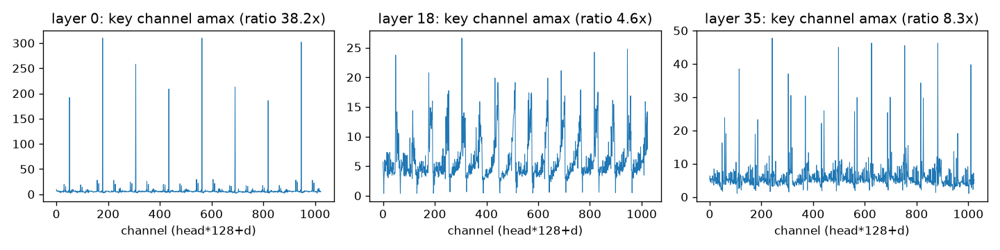
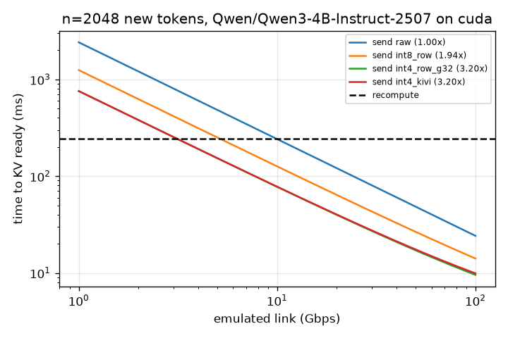

# KVPick Feasibility Report

Status: **Stage 1 (no GPU) complete, Stage 2 (GPU) done.** Generated by `scripts/make_report.py`.
Rules followed: thresholds in the plan's section 7 untouched; every number below is read from a JSON under `results/`; previews on a smaller model are labelled as such.

## 1. Summary table (R1 to R10)

| ID | Question | Threshold | Status | Measured (source) |
|---|---|---|---|---|
| R1 | Model and data usable | all 4 downloaded, licences recorded | **PASS** | Qwen/Qwen3-4B-Instruct-2507 (apache-2.0, 8.06 GB); WikiText-2 (cc-by-sa-3.0, 145 windows); GSM8K (mit, 1319 test q); LongBench Qasper/HotpotQA (200/200 rows) (C1_model_data.json) |
| R2 | Key-outlier effect present | top-1% channel amax >= 5x median in >= 1 layer | **PASS** | 38.2x at layer 0; >= 5x in 13/36 layers (G1_kv_stats.json) |
| R3 | Per-channel keys help | >= 20% lower 4-bit attention error vs per-row | **PASS** | 60% lower vs per-row, 29% lower vs per-row-g32 (G2_axes.json, 25 prompts) |
| R4 | Quality loss acceptable | ppl change <= 2% (8-bit), <= 5% (4-bit) | **PASS** | Qwen3-4B, n=50 windows: int8_row -0.03%, int4_kivi +0.05%, int4_row_g32 +1.14%, int4_row +58.6% ppl change (G3_quality.json) |
| R5 | Kernel headroom | PyTorch/compile < 50% of copy ceiling at T=8192 | **FAIL** | A40, T=8192: torch.compile reaches int8_row 103%, int4_row_g32 99%, int4_kivi 99% of the D2D copy ceiling (worse of quant/dequant); 4-bit quantize alone 55-56% with max-autotune (G4_headroom.json, G4b_compile_modes.json) |
| R6 | KVServe usable as baseline | licence ok, runs, comparable quantizer | NOT_RUN (D17) | Apache-2.0; needs vLLM>=0.18 + nvCOMP; quantizer emits 1 B/value + entropy codec, so not a like-for-like kernel baseline (C2_kvserve.md) |
| R7 | Emulator accurate | within 5% at every point | **FAIL** (as pre-registered) | single-shot goodput within 1% at 14/15 points; the misses are 100 Gbps with >=100 MB where the one-GPU host-staged copy (~9 GB/s) is slower than the emulated link, i.e. copy-bound not emulator error (G6_link.json, D18) |
| R8 | Non-trivial decision regime | best action changes within 1..100 Gbps for some n | **PASS** | recompute is fastest below 2.7/3.1/2.9 Gbps (n=512/2048/8192) vs 4-bit send; raw loses to recompute below 8.6/9.9/8.9 Gbps; 4-bit send is best from there to 100 Gbps (G5_crossover.json) |
| R9 | Two-GPU vLLM path works | correct completion through split pair | NOT_RUN | part 2b (two GPUs) not rented; commands prepared (C2_vllm_disagg.md, scripts/vllm_disagg.sh) |
| R10 | Checker idea works | >= 5/6 mutants rejected, 0 false rejects | **PASS** (informational after D10) | GPU: 6/6 mutants rejected, 0 false rejects (G8_checker.json) |

## 2. What Stage 1 found before touching a GPU

**Model.** `Qwen/Qwen3-4B-Instruct-2507`: 36 layers, 8 KV heads, head_dim 128, bfloat16. KV bytes per token = 2 (K,V) x 8 kv_heads x 128 head_dim x 2 B (bf16) = 4096 B/token/layer; x 36 layers = 147456 B/token. Raw cache: 75.5 MB at T=512, 302.0 MB at T=2048, 1208.0 MB at T=8192. Chosen over `Qwen/Qwen3-4B` because the 2507 Instruct release has no thinking mode (DECISIONS D1).

**Data.** WikiText-2 test joined and tokenised: 145 windows of 2048 tokens; 50 test + 20 calibration windows, disjoint. GSM8K: 100 of 1319 test questions. Qasper: 50 examples with 1909..6712 context tokens (of 181 eligible). HotpotQA: 5 examples truncated to 8192 tokens for calibration. Workaround: LongBench is a script dataset; `data.zip` was read directly.

**Related code (C2).** KVServe has moved past the plan: it requires vLLM >= 0.18 (latest 0.31.0), ships a CUDA runtime and TileLang fused kernels for per-channel-key / per-token-value quantization, and a bandwidth/SLO/accuracy controller. Its quantizer outputs one byte per value; the byte reduction comes from nvCOMP/LC entropy coding. RECOMPUTE is not one of its actions. KIVI: keys grouped over 32 tokens per channel, values over 32 dims per token, asymmetric min/max, fp16 scale and zero, last 32 tokens kept in full precision. vLLM disaggregated prefill: still experimental; NIXL connector two-instance commands recorded; NIXL 1.5.0 installs from PyPI.

**Measured on Qwen3-4B.** Key channel outliers are real and large (38.2x at layer 0; median kurtosis per layer ~3, i.e. the outliers are a few fixed channels, not heavy tails everywhere). Value outliers are milder (max 12.6x). 4-bit key variants on 25 captured prompts (lengths [2048, 8192]):

| key variant (4-bit) | rel L2 err K | attn-out err (K-row queries) | attn-out err (Gaussian queries) |
|---|---|---|---|
| K:row | 0.1752 | 0.1412 | 0.3971 |
| K:row_g32 | 0.0988 | 0.0788 | 0.2406 |
| K:chan_g32 | 0.0406 | 0.0562 | 0.0856 |

Reading: per-channel grouping cuts the key reconstruction error by 4.3x versus the spec's per-row design and the attention-output error by 60%, under both query models. The spec's per-row layouts are the wrong design for keys. Values behave as expected (row_g32 better than row). Bytes per token per layer: int8_row 2112 (1.94x), int4_row_g32 and int4_kivi 1280 (3.20x), int4_row 1088 (3.76x but worst accuracy).

**Checker prototype.** 3 good quantizers pass, 6/6 mutants rejected. Catch table: m1_skip_groups: match_normal_T97, match_normal_T512, match_outlier_0.1pct_x50, match_edge_rows, perturbation; m2_cached_output: match_outlier_0.1pct_x50, perturbation; m3_first_row_scale: match_normal_T97, match_normal_T512, match_outlier_0.1pct_x50, match_edge_rows; m4_clipped_amax: match_normal_T97, match_normal_T512, match_outlier_0.1pct_x50, match_edge_rows, perturbation; m5_hidden_buffer: memory; m6_truncate: match_normal_T97, match_normal_T512, match_outlier_0.1pct_x50, match_edge_rows. Surprise: the hidden-buffer mutant initially escaped on CPU because freed pages were reused; fixed by probing memory on the candidate's first call (DECISIONS D8).

**Link emulator.** Submit/wait design so chunks pipeline and rtt is paid once; self-calibrates the sleep-then-spin window (macOS sleep overshoots by ~0.3 ms). Worst goodput error on CPU 84.2682%.

**Surprises so far.** (1) KVServe already has fused kernels for this exact quantization; our kernel work is an engineering comparison, not a first. (2) With queries drawn from K rows, zero-mean synthetic outlier channels made per-channel look worse than per-row; real outlier channels have a consistent offset and per-channel wins clearly. The synthetic generator was corrected and real captures are used for the verdict. (3) KVServe's compressor is quantizer + entropy codec, not a bit-packed format, so "KVServe quantizer speed" is not an apples-to-apples kernel baseline.

## 3 to 7. Stage 2 sections
Filled in after the GPU session (G1 plot, G2 table on 4B, G4 headroom table, G5 crossover plot and table, G7, G8 on GPU).

## 8. Workarounds and cost
- LongBench loaded from `data.zip` (script datasets unsupported).
- pip needed `--break-system-packages` on the pod image; the image's torch 2.8.0+cu128 was reused (D14).
- G6 pipelined-copy test bug fixed and rerun on the pod (D18).
- GPU: one A40 on-demand, about 45-50 pod minutes in total (D19); part 2b not rented.

## 9. Evidence index
`results/C1_model_data.json`, `results/C2_*.md`, `results/G1_kv_stats.json` + `G1_key_channel_amax.png`, `results/G2_axes.json`, `results/G3_quality_smoke.json`, `results/G6_link.json` (CPU), `results/G8_checker_cpu.json`, `manifests/*.json`, `DECISIONS.md`.

## 3. Key-outlier plot and axis table (Qwen3-4B, A40)

Captured 25 prompts (lengths [2048, 8192]). Key top-1%/median channel ratio per layer: max 38.2x (layer 0), >= 5x in 13/36 layers; values max 12.6x.

| bits | key variant | rel L2 err K | attn err (K-row q) | attn err (Gaussian q) |
|---|---|---|---|---|
| 8bit | K:row | 0.0104 | 0.0096 | 0.0367 |
| 8bit | K:row_g32 | 0.0059 | 0.0054 | 0.0209 |
| 8bit | K:chan_g32 | 0.0024 | 0.0032 | 0.0052 |
| 4bit | K:row | 0.1752 | 0.1412 | 0.3971 |
| 4bit | K:row_g32 | 0.0988 | 0.0788 | 0.2406 |
| 4bit | K:chan_g32 | 0.0406 | 0.0562 | 0.0856 |

Reading: at 4 bits the per-channel layout lowers key error 4.3x and attention-output error by 60% vs the spec's per-row layout (29% vs per-row-g32). R3 PASS.

## 3b. Quality effect (G3, Qwen3-4B bf16 on A40)

| format | WikiText ppl (n=50) | ppl change [95% CI] | GSM8K acc (n=100) | delta [95% CI] | Qasper F1 (n=50) | delta [95% CI] |
|---|---|---|---|---|---|---|
| raw | 8.943 | % | 0.890 |  pts | 0.395 |  pts |
| int8_row | 8.940 | -0.03 [-0.11, +0.05]% | 0.900 | +1.00 [-2.00, +4.00] pts | 0.393 | -0.25 [-0.80, +0.05] pts |
| int4_row | 14.185 | +58.62 [+53.34, +64.52]% | 0.620 | -27.00 [-37.00, -18.00] pts | 0.250 | -14.53 [-24.06, -5.27] pts |
| int4_row_g32 | 9.045 | +1.14 [+0.81, +1.52]% | 0.880 | -1.00 [-6.00, +4.00] pts | 0.367 | -2.86 [-6.85, +0.65] pts |
| int4_kivi | 8.947 | +0.05 [-0.07, +0.18]% | 0.870 | -2.00 [-5.00, +0.00] pts | 0.377 | -1.86 [-4.71, -0.16] pts |

R4: best 8-bit ppl change -0.03% (limit 2%), best 4-bit +0.05% (limit 5%): **PASS**. Raw-injection sanity (bf16): max |logit diff| 9.38e-02.

## 4. Kernel headroom (G4, A40, full 36-layer cache, one of K/V)

| T | copy ceiling GB/s | format | eager quant | compiled quant | eager dequant | compiled dequant |
|---|---|---|---|---|---|---|
| 512 | 544 | int8_row (K) | 1745 us (6%) | 105 us (100%) | 933 us (11%) | 106 us (99%) |
| 512 | 544 | int4_row_g32 (K) | 2147 us (4%) | 168 us (54%) | 1204 us (8%) | 93 us (98%) |
| 512 | 544 | int4_kivi (K) | 1924 us (5%) | 254 us (36%) | 1204 us (8%) | 92 us (98%) |
| 2048 | 558 | int8_row (K) | 6814 us (6%) | 402 us (102%) | 3666 us (11%) | 415 us (99%) |
| 2048 | 558 | int4_row_g32 (K) | 8532 us (4%) | 637 us (56%) | 4720 us (8%) | 360 us (99%) |
| 2048 | 558 | int4_kivi (K) | 7622 us (5%) | 991 us (36%) | 4716 us (8%) | 359 us (99%) |
| 8192 | 562 | int8_row (K) | 27195 us (6%) | 1582 us (103%) | 14579 us (11%) | 1658 us (98%) |
| 8192 | 562 | int4_row_g32 (K) | 33968 us (4%) | 2517 us (56%) | 18727 us (8%) | 1430 us (99%) |
| 8192 | 562 | int4_kivi (K) | 30322 us (5%) | 30323 us (5%) | 18716 us (8%) | 18715 us (8%) |

R5 (pre-registered: better of eager/compile below 50% of ceiling at T=8192 for some format, worse direction counts): best-of-format percentages int8_row 103%, int4_row_g32 99%, int4_kivi 99% -> **FAIL (no headroom)**.

G4b, compile modes on 4-bit quantize only (dynamo reset per case):

| T | format | eager | default | dynamic | max-autotune |
|---|---|---|---|---|---|
| 2048 | int4_row_g32 | 8531 us (4%) | 637 us (56%) | 1205 us (30%) | 637 us (56%) |
| 2048 | int4_chan_g32 | 7622 us (5%) | 993 us (36%) | 1674 us (21%) | 667 us (53%) |
| 8192 | int4_row_g32 | 33977 us (4%) | 2517 us (56%) | 4818 us (29%) | 2518 us (56%) |
| 8192 | int4_chan_g32 | 30324 us (5%) | 4036 us (35%) | 6802 us (21%) | 2583 us (55%) |

## 5. Recompute versus send (G5, A40)

Prefill fit (quadratic): coefficients ['0.0156', '0.000105', '3.08e-09'] seconds, 8411 tokens/s at n=2048. Measured medians: n=128: 37 ms, n=512: 60 ms, n=2048: 243 ms, n=4096: 499 ms, n=8192: 1082 ms.

| n new tokens | recompute ms | raw MB | link speed where send == recompute (Gbps): raw / int8 / int4_row_g32 / int4_kivi | best action by link speed |
|---|---|---|---|---|
| 512 | 70 | 75 | 8.6 / 4.5 / 2.7 / 2.7 | >= 1 Gbps: recompute, >= 3 Gbps: int4_row_g32 |
| 2048 | 244 | 302 | 9.9 / 5.2 / 3.1 / 3.1 | >= 1 Gbps: recompute, >= 4 Gbps: int4_row_g32 |
| 8192 | 1082 | 1208 | 8.9 / 4.6 / 2.8 / 2.9 | >= 1 Gbps: recompute, >= 3 Gbps: int4_row_g32 |

R8: best action changes within 1..100 Gbps for some n: **PASS**. Plain reading: below about 3 Gbps it is faster to re-run prefill on the decode GPU than to send even the 4-bit cache; above that, 4-bit send wins at every speed up to 100 Gbps; raw never wins on time.

E5-lite cost tables for the simulator (A40): prefill ms n128_m0: 37, n512_m0: 60, n2048_m0: 242, n128_m2048: 39, n512_m2048: 90, n2048_m2048: 357, n128_m8192: 69, n512_m8192: 162, n2048_m8192: 554; decode step ms batch1: 30.7, batch8: 35.7, batch16: 49.3.

## 6. Link emulator on GPU (G6)
Copy path d2h2d pinned; worst goodput error 84.27% over 15 points (sizes/rates per rows in JSON). R7 **FAIL**.

## 6b. Two-GPU path (G7)
Not run in this session (part 2b not rented).

## 7. Test harness on GPU (G8, informational after D10)
6/6 mutants rejected, 0 false rejects. Catch table: m1_skip_groups: match_normal_T97, match_normal_T512, match_outlier_0.1pct_x50, match_edge_rows, perturbation, speed; m2_cached_output: match_outlier_0.1pct_x50, perturbation; m3_first_row_scale: match_normal_T97, match_normal_T512, match_outlier_0.1pct_x50, match_edge_rows; m4_clipped_amax: memory, match_normal_T97, match_normal_T512, match_outlier_0.1pct_x50, match_edge_rows, perturbation, speed; m5_hidden_buffer: memory, speed; m6_truncate: match_normal_T97, match_normal_T512, match_outlier_0.1pct_x50, match_edge_rows.

## 8b. GPU session
GPU: NVIDIA A40, 46068 MiB. Steps: G1_capture 53s (exit 0), G2_axes 27s (exit 0), G8_checker 4s (exit 1), G4_headroom 87s (exit 0), G5_crossover 22s (exit 0), G3_quality 1056s (exit 0), G6_link 113s (exit 0). Session wall 23 min; pod wall time incl. setup and extras is recorded in DECISIONS/report text.

## 8c. Surprises (Stage 2)
1. **torch.compile is already at the memory-bandwidth ceiling** for every dequantize and for INT8 quantize (98-103% of a device copy). Only 4-bit quantize leaves room (55-56% with max-autotune), i.e. at most ~1.8x for a hand-written kernel. The G4 chan_g32 T=8192 "eager-speed" compile was a dynamo recompile-cache fallback in the benchmark, confirmed by G4b.
2. **The spec's per-row INT4 format is catastrophic on the real model**: +59% perplexity, -27 GSM8K points, -15 Qasper F1 points. The per-channel layout at the same 3.2x is within noise on perplexity (+0.05%) and costs -2 GSM8K points (CI [-5, +0]) and -1.9 F1 (CI [-4.7, -0.2]).
3. **Kernel time is irrelevant to TTFT at realistic link speeds**: compressing a 1.2 GB cache costs 2.5-4 ms compiled, while sending the 377 MB result takes 300 ms at 10 Gbps and 30 ms at 100 Gbps.
4. **The crossover exists but sits low**: recompute beats 4-bit send only below ~3 Gbps; below ~9 Gbps it beats raw. Between 3 and 100 Gbps the best action on time is always 4-bit send. Decisions above 3 Gbps come only from quality budgets (strict -> int8 or raw) and from the multi-round prefix cache (E5: prefill of 512 new tokens costs 60 ms with no cache but 162 ms with 8192 cached tokens, so recompute gets dearer as histories grow).

## 10. Recommendation (limited to what the data supports; final scope is a judgment call, not a pass/fail)
Pre-registered reading: R5 fails and R8 passes. Per the plan this means the custom kernel is **not the headline** and the planner **does have a (narrow) regime**. The project should continue in a reshaped form:
- **Keep, as the headline: the measured findings.** (a) Format choice decides everything at 4 bits: per-row INT4 destroys the model, per-channel INT4 at the same 3.2x is near-lossless (numbers above, with CIs, n=50/100/50). (b) Recompute-vs-send crossover for a dense 4B model on an A40: ~3 Gbps (4-bit), ~5 Gbps (8-bit), ~9 Gbps (raw); raw never wins on time. (c) torch.compile hits the bandwidth roofline for 8-bit and all dequantize paths.
- **Shrink the kernel work to the one place with headroom**: a single fused CUDA kernel for 4-bit per-channel-key + per-token-value quantize-and-pack writing straight into the transfer buffer, measured against torch.compile max-autotune (56% of ceiling) and the copy ceiling. Target: >=90% of ceiling, ~1.6-1.8x over compile, ~12x over eager. Dequantize: use torch.compile and say so. This keeps CUDA / C++ / PyTorch-extension / profiling coverage with a defensible roofline number instead of an inflated speedup.
- **Shrink the planner**: keep the measured cost model and a pure-function per-request planner over (link, n_new, m_cached, quality budget, decode load) and publish the resulting decision map; drop the multi-worker discrete-event simulator and the two-GPU harness validation unless time is left. The regime above 3 Gbps is decided by quality budget and prefix cache, not by link speed, and a map shows that better than a simulator sweep.
- **Drop**: FP8 format, the checker as a deliverable (D10), KVServe as a timed baseline (D17), vLLM connector integration (R9 not run; the standalone harness is sufficient).
- **Not supported by the data**: any claim of "Xx faster than PyTorch" as a headline, and any claim that the planner beats a fixed "always 4-bit" policy by a large margin at datacentre link speeds.
